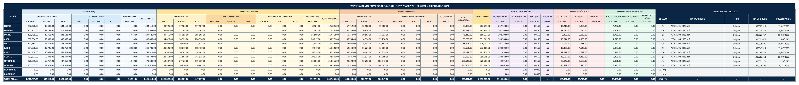

# Consolidador de PDT 621 → Excel

Herramienta de escritorio que lee los PDF de las declaraciones **PDT 621 (IGV – Renta Mensual) de SUNAT** y genera, por empresa y por año, un Excel con el resumen tributario de los 12 meses.

Nace de una tarea repetitiva en contabilidad: copiar a mano los casilleros de cada declaración mensual a una hoja de trabajo. Con esta herramienta se selecciona una carpeta con los PDF y el Excel queda listo en segundos.

## Qué hace

- Lee todos los PDF de una carpeta y **descarta automáticamente** las constancias de presentación o de pago (NPS, Formulario 1662, etc.).
- Identifica el **RUC, la razón social, el período, el N.º de orden, el tipo de declaración y la fecha de presentación**.
- Extrae **más de 70 casilleros** del PDT 621: ventas, compras, IVAP, renta, determinación de la deuda, percepciones y retenciones.
- Funciona con PDF del **Aplicativo Desktop** (2 páginas) y del **Portal SUNAT** (3 páginas).
- Agrupa los PDF **por RUC y año**: genera un Excel por empresa.
- Si un mes tiene **original y rectificatoria**, pregunta cuál usar y sugiere la presentada más recientemente.
- Detecta si el contribuyente se acogió a la **prórroga del IGV Justo**.

## Qué contiene el Excel

**Hoja RESUMEN**: una fila por mes y una fila de total anual, con fórmulas enlazadas a las hojas mensuales.

| Bloque | Detalle |
|---|---|
| Ventas | Gravadas 18 %, Ley 31556 (10.5 %), no gravadas / exportaciones, total |
| Compras nacionales | Gravadas 18 %, Ley 31556, mixtas, no gravadas, total |
| Compras importadas | Gravadas 18 %, mixtas, no gravadas, total |
| Total compras | Nacionales + importadas |
| Renta y auditoría | Ingresos netos (cas. 301), **alerta de diferencia entre la base del IGV y la de Renta**, coeficiente o porcentaje aplicado, IGV Justo |
| Determinación SUNAT | IGV resultante (cas. 184), Renta resultante (cas. 304), pagos realizados |
| Percepciones y retenciones | Casilleros 171, 164 y 165 |
| Declaración utilizada | PDF de origen, tipo, N.º de orden y fecha de presentación |

**Hojas PDT 01 a PDT 12**: el valor de cada casillero del mes, con su descripción.



*Ejemplo con una empresa ficticia (EMPRESA DEMO COMERCIAL S.A.C.). Todos los montos son inventados.*

## Instalación

Requiere Python 3.10 o superior.

```bash
pip install -r requirements.txt
python resumen_pdt621.py
```

Si faltan las librerías, el programa intenta instalarlas solo la primera vez.

## Uso

1. Pulsa **Explorar...** y elige la carpeta con los PDF del PDT 621.
2. Elige la carpeta donde se guardará el Excel (por defecto, la misma).
3. Pulsa **GENERAR EXCEL(S) RESUMEN**.
4. Si algún mes tiene más de una declaración, elige cuál usar.

Se genera un archivo `RESUMEN_PDT621_<año>_<RUC>_<razón social>.xlsx` por cada empresa y año.

## Pruebas

```bash
python -m unittest -v
```

Las pruebas usan solo datos ficticios.

## Confidencialidad

Este repositorio **no contiene declaraciones ni datos de contribuyentes reales**. El `.gitignore` impide subir archivos `.pdf` y `.xlsx` por accidente.

## Tecnologías

Python · [pdfplumber](https://github.com/jsvine/pdfplumber) (lectura de PDF por coordenadas) · [openpyxl](https://openpyxl.readthedocs.io/) (generación del Excel) · Tkinter (interfaz)

## Autor

**Mauro I. Rojas Molina**

## Licencia

Distribuido bajo la licencia [MIT](LICENSE). Puedes usar, modificar y compartir el código libremente, siempre que conserves el aviso de copyright a nombre de Mauro I. Rojas Molina.
